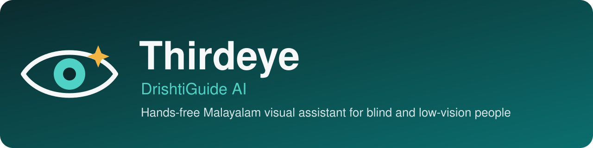
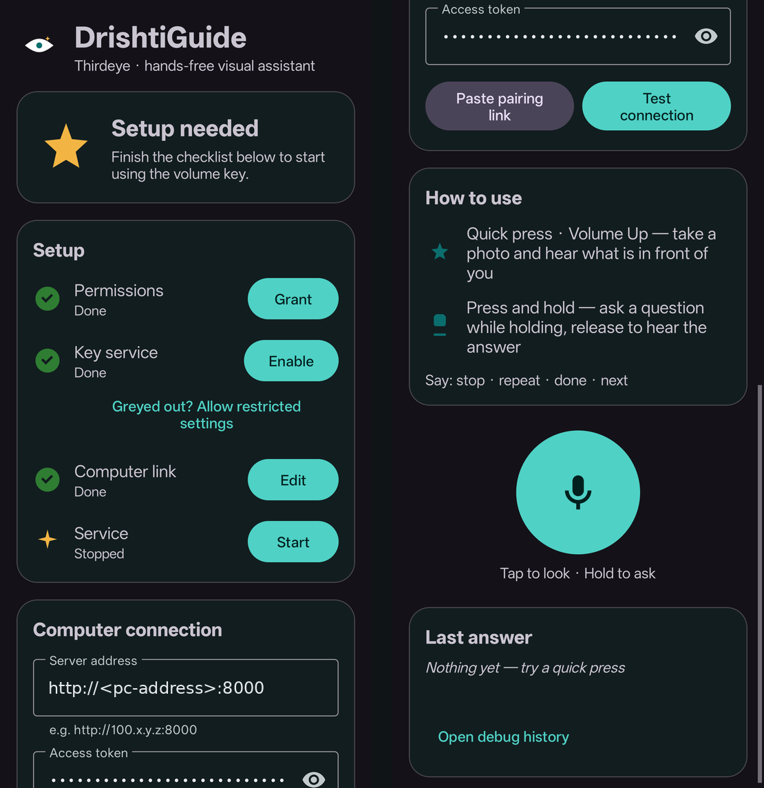
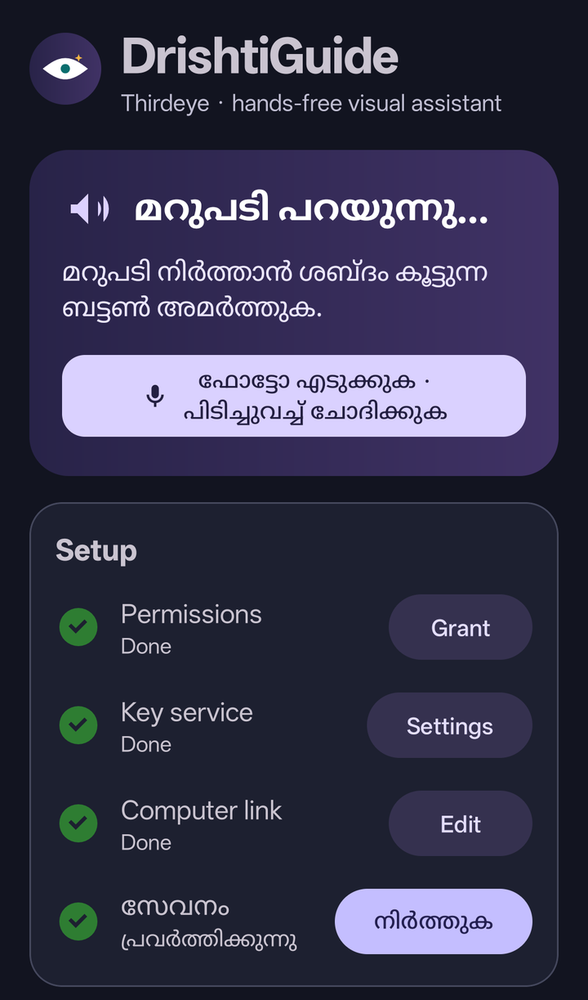
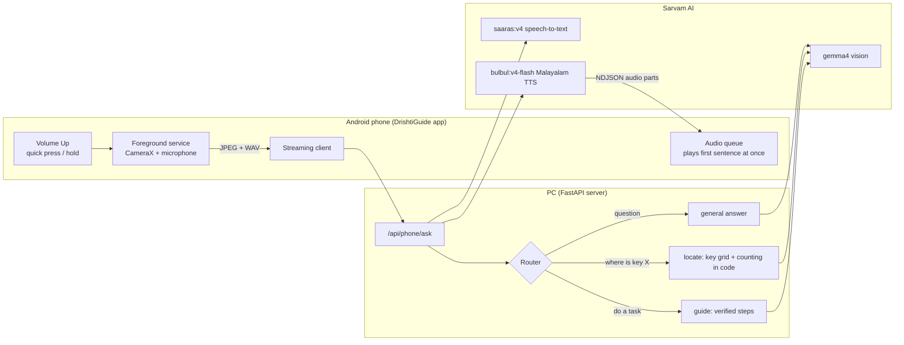
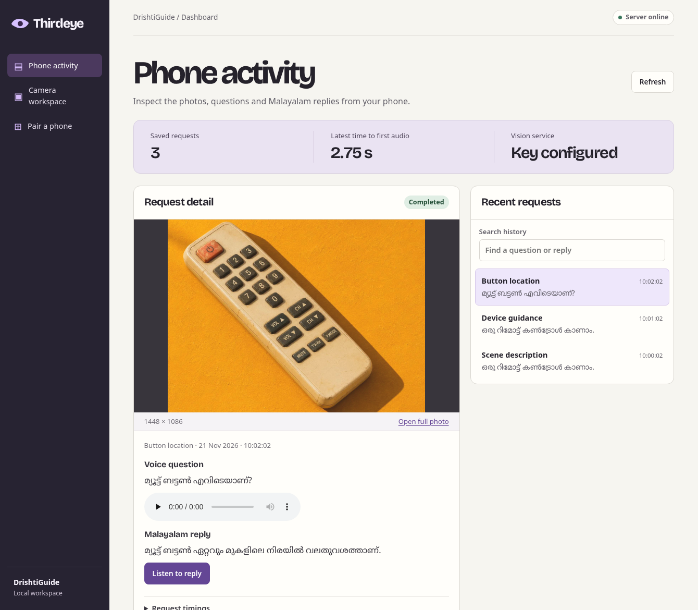

<p align="center">
  
</p>

<p align="center">
  <a href="https://github.com/1kailas/Thirdeye/actions/workflows/ci.yml"></a>
  
  
  
  
  
</p>

<h3 align="center">A third eye you can hold. Press a key, ask in your own language, and hear the answer in Malayalam.</h3>

**Thirdeye (DrishtiGuide AI)** turns an ordinary Android phone into a hands-free visual assistant for blind and low-vision people. Press **Volume Up** to hear what is in front of you. **Hold it** to ask a question, then let go. The phone takes the photo, listens to your voice, and speaks a short answer in natural Malayalam. It can read labels, describe scenes, and tell you exactly which key on a remote to press, such as *"fourth row from the bottom, third key from the left"*.

> Built at **HackaThoni · The Houseboat Hackathon** (Alappuzha, 21-22 Nov 2026) for **Track 03 "Beyond the Screen"**, with a cross-track in **Track 02 "Beyond English"**. See [Hackathon track](#hackathon-track).

<p align="center">
  
  
  <br><em>On a Realme RMX3870. The light screen shows setup. The dark screen shows the assistant speaking a reply.</em>
</p>

---

## Table of contents

- [Why this exists](#why-this-exists)
- [What it can do](#what-it-can-do)
- [How it works](#how-it-works)
- [Hackathon track](#hackathon-track)
- [How Sarvam AI is used](#how-sarvam-ai-is-used)
- [Built with Devin](#built-with-devin)
- [Quick start](#quick-start)
- [Project website](#project-website)
- [Using it](#using-it)
- [Spatial guidance: "where is the button?"](#spatial-guidance-where-is-the-button)
- [Dial guidance](#dial-guidance)
- [Speed](#speed)
- [Local dashboard and history](#local-dashboard-and-history)
- [Configuration](#configuration)
- [Security, privacy and safety](#security-privacy-and-safety)
- [Testing](#testing)
- [Project layout](#project-layout)
- [Roadmap](#roadmap)
- [Contributing](#contributing)
- [License](#license)

---

## Why this exists

Blind and low-vision people in Kerala often cannot use everyday objects on their own. Remote controls, washing-machine panels, medicine strips and packaged food all depend on small printed labels. Most visual-assistance tools are English-first, need the user to find and tap a screen, or describe a scene without helping the person act on it.

Thirdeye is built around three ideas:

1. **No screen.** The trigger is a hardware key. It works with the app in the background and, on supported phones, with the screen off.
2. **Malayalam first.** You can speak Malayalam, English or Hindi. The answer always comes back as spoken Malayalam.
3. **Precise, not vague.** For controls, it counts rows and keys in code instead of saying "somewhere near the top", and it will not guess when it cannot see clearly.

## What it can do

| Ability | Example | How |
| --- | --- | --- |
| **Describe the scene** | Quick press with no question: *"In front of you there is a wooden table with two green bottles."* | `general` route |
| **Answer any question about the photo** | Hold and ask *"What is the time on the screen?"* | `general` route, 1-3 short sentences |
| **Read text aloud** | *"Read this label."* | Vision model, text copied exactly |
| **Find a key by counting** | *"Where is the exit button?"* gives *"'EXIT' is in the fifth row from the top, first key from the left. Second row from the bottom."* | `locate` route, see below |
| **Guide your finger** | With a finger visible: *"Move one key left and two rows down."* | `locate` route |
| **Step-by-step appliance help** | *"How do I turn the fan down?"* gives a physical landmark and one movement, with a photo check when the result is visible. | `guide` route, before/after photo check |
| **Voice commands** | *repeat, stop, done, next step, where is the button, start over* (Malayalam and English) | Intent table |
| **Safety refusal** | Gas, mains electricity, medical and industrial equipment get a caution, not instructions | Prompt rules and the guide schema |
| **Explain missing evidence** | If the photo shows the dial scale but hides its pointer, the guide can explain which detail it still needs. | Structured guidance and retake handling |

## How it works



One turn, in plain words:

1. You press or hold **Volume Up**. The phone buzzes, takes the photo and (on hold) records your voice while the key is down.
2. On release, the app uploads the photo and recording to your PC over Tailscale or Wi-Fi. A quiet tick plays while it thinks.
3. The server transcribes your speech (any of Malayalam, English or Hindi), decides what you want, and asks the vision model.
4. The reply is split into sentences, and each is turned into Malayalam speech **in parallel**. The phone starts speaking the first sentence while the others are still being generated.

More detail, with the API contract and failure handling, is in [docs/ARCHITECTURE.md](docs/ARCHITECTURE.md).

## Hackathon track

**Event:** HackaThoni, *The Houseboat Hackathon*, Alappuzha, 21-22 November 2026.

| | Track | Fit |
| --- | --- | --- |
| **Primary** | **03 · Physical-world computing: "Beyond the Screen"**. *Build software that understands or responds to the physical world. Work with images, movement, location or sensor inputs instead of relying only on text prompts.* | Thirdeye's input is the camera and a hardware key, not a text box. Its "possible direction" **Visual assistance** is the whole product: scene description, label reading, and key-by-key spatial guidance. The hold-to-ask gesture is a sensor-driven interaction with no screen. |
| **Cross-track** | **02 · Voice & language: "Beyond English"**. *Use Sarvam's language and speech tools to make technology more useful for people who prefer Indian languages or voice interaction.* | Speech in (Malayalam, English, Hindi, auto-detected), Malayalam speech out, Sarvam STT, vision and TTS in every turn. Its "possible directions" **Malayalam voice interfaces** and **Speech-led workflows** map directly. |

The scope is deliberately focused. The result is a working demo on a real phone, with a measurable latency and a script in [docs/DEMO.md](docs/DEMO.md).

## How Sarvam AI is used

The server sends photos to vision, sends voice questions to speech recognition when present, and requests Malayalam audio for spoken replies. The API key is configured on the PC.

| Stage | Sarvam service | Model | Why it fits |
| --- | --- | --- | --- |
| Hear | Speech-to-Text REST | `saaras:v4`, `language_code=unknown` | Indic-first recognition with automatic language detection. A user can speak Malayalam, English or Hindi without changing a setting. |
| See | Chat Completions v2 with image input | `gemma4` (configurable alternative `glm5.3-flash`) | Fast image understanding through `data:` URLs. We use strict `json_schema` structured output so the app gets typed results (`Answer`, `Locate`, `Guidance`, `Verification`) instead of free text. |
| Speak | Text-to-Speech REST | `bulbul:v4-flash`, `ml-IN` | Natural Malayalam voice. Calls run in parallel per sentence to get the first sound out sooner. |

Engineering notes from working with the APIs:

- **Structured output hardening.** Under strict JSON schema, `gemma4` sometimes padded its answer with blank lines until it hit the token limit, which truncated the JSON. We now ask for a compact single-line object and retry once if the output is unparseable or cut off. In live tests, 5 of 5 appliance tasks succeeded after the change, in 2-6 seconds.
- **Language handling.** Detection is delegated to `saaras:v4`. The answer language is fixed to Malayalam in the prompt so that the voice output stays consistent.
- **Cost awareness.** Short replies (1-3 sentences) keep output tokens, TTS time and listening time low. The system prompts are stable so Sarvam's prompt caching can apply.

## Built with Devin

This project was built end to end with **[Devin](https://devin.ai)** (Cognition's AI software engineer, running in Devin Desktop) as the pair programmer, working from the real phone and the real Sarvam APIs rather than mocks alone.

- **Design and API research.** Devin read the Sarvam documentation, checked model IDs, speaker names and limits, and told us early that Android cannot expose power-button hold and release. That moved the trigger to Volume Up.
- **Full-stack implementation.** The FastAPI phone API, routing, streaming, the key-grid locate composer, the Kotlin app (foreground service, CameraX, audio recorder, accessibility key filter, trigger state machine), the Material 3 UI, CI and docs.
- **On-device debugging over adb.** Devin installed the APK, tapped through the install prompts, read `logcat`, and found real bugs that unit tests could not:
  - `Camera is not active`: the service never reached the started state because `onStartCommand` did not call `super`.
  - The accessibility service was greyed out by Android's "Restricted settings" for sideloaded apps, so the app now guides the user through it.
- **Measured, not guessed.** Latency was benchmarked before and after each change, which is how streaming and per-sentence TTS ended up cutting time to first sound for a descriptive question from about 2.8 s to about 1.2 s.
- **Delegation with review.** A lead agent planned the changes and a second agent implemented and built them. Every diff was read before it landed, which caught bugs such as a service that would crash at start-up (a `Context` used in a field initialiser), stale timers cutting a recording short, a microphone left open after a very short press, and corrupted Malayalam strings in generated text.
- **Honest limits.** Devin could not hear the audio or judge Malayalam fluency, so the quality of the spoken Malayalam was checked by its maker, and a review by native speakers and blind users is still needed.

## Quick start

### 1. The server (your PC)

```sh
git clone https://github.com/1kailas/Thirdeye.git
cd Thirdeye
cp .env.example .env && chmod 600 .env
```

On the PC, generate a token with `python -c "import secrets; print(secrets.token_urlsafe(32))"`. Set the following values in `.env`, replacing both placeholders.

```dotenv
SARVAM_API_KEY=your-sarvam-api-key
CAMERA_URL=off
HOST=0.0.0.0
PHONE_TOKEN=paste-your-generated-token-here
```

Run `./start.sh` on Linux to start the server in the background. The first launch creates `.venv` and installs dependencies. Read the output in `logs/server.log` and use `./stop.sh` to stop it. For a foreground session, run `./run.sh`.

### 2. The phone

```sh
cd android
./gradlew assembleDebug                         # JDK 17 + Android SDK 34
adb install -r app/build/outputs/apk/debug/app-debug.apk
```

On the phone, open **DrishtiGuide**, tap **Grant**, and enable the **key service** in Accessibility settings. The checklist in the app shows what is missing. On Android 13+ the key service may be greyed out for a sideloaded app. Install with `adb install` as above, or use the in-app **Allow restricted settings** button. Full steps are in [android/README.md](android/README.md).

### 3. Pair

With the server running, open `http://127.0.0.1:8000/pair` on the PC and scan the QR with the phone camera. If the camera app cannot open it, expand **Manual pairing link**, copy the link to your phone, and tap **Paste pairing link** in the app. Or type `http://<pc-address>:8000` and the token by hand. Use Tailscale or a trusted Wi-Fi network, because the link is plain HTTP.

Once paired, tap **തുടങ്ങുക** (Start) on the phone. You’ll hear the service and Volume Up instructions in Malayalam. Tap **നിർത്തുക** (Stop) to stop the phone service.

## Project website

Try the button-finder demo in your browser and hear the Malayalam directions. [Project website](https://1kailas.github.io/Thirdeye/)

GitHub Pages publishes the static site from the `/docs` folder on `main`. The phone and dashboard connect to the FastAPI server on your PC. [Site source](docs/index.html)

## Using it

| Gesture | What happens |
| --- | --- |
| **Quick press** Volume Up | Photo, then a spoken description of what is in front of you. |
| **Press and hold** | Photo immediately, a vibration pattern, then your voice is recorded while you hold (up to 20 s). Release to send. |
| **Press while it is talking** | Stops the reply and starts a new request. |

Things to try: *"What does this say?"*, *"What is in front of me?"*, *"Where is the exit button?"*, *"How do I start this washing machine?"*. Say *"stop"*, *"repeat"*, *"done"*, *"next step"* or *"start over"* while holding Volume Up. Malayalam equivalents work too.

## Spatial guidance: "where is the button?"

This is the feature we built for the remote-control case.

When you ask where a key is, the vision model does **not** write the directions. It returns a small grid map: the rows of keys from top to bottom, each row's labels from left to right, the target key's row and column, and (if your finger is visible) the key under your fingertip. **Plain Python code then does the counting and writes the Malayalam sentence.** Enumerating keys is something vision models do reliably; free-form "it's near the middle-left" is not.

```text
Q: "Where is the exit button?"        grid the model returned
                                      [POWER, MUTE]
reply: 'EXIT' is in the fifth row     [1, 2, 3]
from the top, first key from the      [4, 5, 6]
left, second row from the bottom,     [7, 8, 9]
next to '0'.                          [EXIT, 0, OK]   <- target (row 5, col 1)
                                      [◀, ▲, ▼, ▶]

Finger on '5' (row 3, col 2):  "Move one key left and two rows down."
```

- It remembers the last target, so *"and now?"* after you move your finger keeps guiding to the same key.
- It refuses to guess: unreadable, rotated or cut-off photos produce a request for a better picture.
- On our synthetic remote, 9 of 9 live runs returned the correct grid and the correct sentence, and an absent key (*"volume up"*) was reported as not found.
- Open **Detected key layout** in the dashboard to inspect the model’s button map.

<p align="center">
  
  <br><em>Phone activity dashboard with example requests and a remote-control photo.</em>
</p>

## Dial guidance

Hold **Volume Up** and ask, for example, “How do I turn this fan down to 1?” The guide reads the markings, locates the knob using a physical landmark, and describes how to move your hand. The direction depends on the dial in the photo.

On a test dial with the pointer at three o’clock and the target at twelve, the guide said **“നോബിന്റെ മുകൾഭാഗം ഇടത്തേക്ക് വരത്തക്കവിധം ഏകദേശം കാൽ വട്ടം തിരിച്ച് നിർത്തൂ.”** This means “Turn the knob about a quarter-turn so its top moves left, then stop.” If only the direction is clear, it can suggest a small turn. Hold Volume Up and say **“ചെയ്തു”** (“done”) so the guide can check the new position in a photo.

## Speed

The slow parts of a turn are speech-to-text, the vision model and speech synthesis. Three changes make it feel faster without changing quality:

1. **Streaming reply.** The server answers as newline-delimited JSON: the text first, then audio parts as each is ready. The phone plays part 1 while part 2 is still being made.
2. **Per-sentence parallel TTS.** The reply is split into at most three parts at sentence boundaries and synthesised concurrently.
3. **Camera pre-warm.** The camera starts opening on key-down, so capture can begin sooner. A stalled capture times out after eight seconds and the app retries once. If both attempts fail, it gives a Malayalam recovery message.

Measured against the real Sarvam APIs from this PC, four runs per cell, an English-spoken question with a 720x1280 test photo of a remote. Results vary from run to run:

| Question | Mode | Time to first sound (median / worst) | Total |
| --- | --- | --- | --- |
| "What is in this picture? Describe it in detail." | one response | 2.81 s / 5.12 s | 2.81 s |
| | **streaming** | **1.19 s / 1.92 s** | 1.22 s |
| "Where is the exit button?" | one response | 1.96 s / 5.11 s | 1.96 s |
| | **streaming** | **1.79 s / 3.38 s** | 1.79 s |

On the phone, the History screen shows *first sound* and *network* timings for every turn. Reproduce the table with `python scripts/bench_stream.py`.

## Local dashboard and history

Open the dashboard on the computer running the server. Its sidebar has three pages.

| Page | What you can do |
| --- | --- |
| [Phone activity](http://127.0.0.1:8000/) | Search the last 30 saved requests. Select one to inspect the submitted photo, original voice question, Malayalam reply, and available timings or button map. Saved history reloads after a server restart. |
| [Camera workspace](http://127.0.0.1:8000/workspace) | Connect an IP Webcam stream, frame a control, ask a typed or dictated question, and compare before-and-after photos. [Browser guide](docs/BROWSER_UI.md) |
| [Pair a phone](http://127.0.0.1:8000/pair) | Choose a network the phone can reach, then scan its QR code or open the manual pairing link. The code and link contain your access token. |

The Android **Debug history** screen keeps the last 20 turns and lets you replay or clear them. On the PC, `/debug` also opens Phone activity when archiving is enabled. For repeatable demonstrations, `scripts/make_demo_remote.py` draws a sample remote and `scripts/bench_stream.py` measures response times.

## Configuration

All settings live in `.env` (copy `.env.example`). Environment variables set before launch win.

| Variable | Example configuration | Meaning |
| --- | --- | --- |
| `SARVAM_API_KEY` | none | Required. Stays on the PC. |
| `PHONE_TOKEN` | none | Required for phone requests. Binding to a non-loopback address requires at least 24 characters. |
| `HOST` / `PORT` | `127.0.0.1` / `8000` | Use `0.0.0.0` so the phone can connect. |
| `CAMERA_URL` | IP Webcam URL | `off` when the phone supplies photos (recommended). |
| `VISION_MODEL` / `VISION_FALLBACK_MODEL` | `gemma4` / `glm5.3-flash` | Vision model and the alternative suggested if access fails. Set `VISION_MODEL` and restart to switch. |
| `STT_MODEL` / `LANGUAGE_CODE` | `saaras:v4` / `unknown` | `unknown` auto-detects speech; `ml-IN` pins Malayalam. |
| `TTS_MODEL` / `TTS_VOICE` / `TTS_PACE` | `bulbul:v4-flash` / `simran_en_customer` / `0.95` | Malayalam voice settings. |
| `IMAGE_MAX_WIDTH` / `JPEG_QUALITY` | `1280` / `82` | Image sent to the model. |
| `PHONE_DEBUG` | `1` | Keep the `debug/` archive and `/debug` page. |
| `PUBLIC_URL` | none | Extra address to offer on the `/pair` page. |

## Security, privacy and safety

- **Token-protected phone API.** `Authorization: Bearer <PHONE_TOKEN>`, compared in constant time. The server will not bind to a non-local address without a token.
- **Local-only pages.** The browser UI, `/debug` and `/pair` only accept connections from the PC itself.
- **Limits.** Photos up to 16 MP / 6 MB, recordings up to 3 MB, requests up to 10 MB.
- **Your data.** The server sends photos, voice questions, and reply text to Sarvam for processing. The phone keeps its own history. By default the PC also stores recent uploads and replies in `debug/`. Set `PHONE_DEBUG=0` and restart to stop new PC archives. Previously saved files remain on disk until you remove them.
- **Plain HTTP.** The app talks HTTP, so use Tailscale or a network you trust. Never expose the server to the public internet.
- **Safety behaviour.** The assistant refuses to give operating instructions for gas, mains electricity, medical or industrial equipment, never identifies people, and says when it cannot see something.
- **Not a certified safety device.** This is an assistive prototype for low-risk everyday tasks. Do not rely on it for medicine dosage, hazards or navigation.

## Testing

```sh
# From the repository root, after starting the server once
.venv/bin/python -m pip install httpx
.venv/bin/python -m unittest discover -s tests
(cd android && ./gradlew testDebugUnitTest assembleDebug)
```

CI runs both on every push, and builds the debug APK as an artifact. The suites are fully offline. To also check a configured IP Webcam and Sarvam account, run `DRISHTIGUIDE_LIVE=1 .venv/bin/python -m unittest discover -s tests -p test_live.py`.

## Project layout

```text
app.py              FastAPI server: phone API, routing, streaming, debug and pairing pages
task_engine.py      Schemas, prompts, task state, locate composer (Malayalam sentences)
sarvam_client.py    Sarvam REST client (STT, vision, TTS) with retries and structured output
camera.py           Optional IP Webcam reader (CAMERA_URL=off for phone-only)
index.html          Local phone activity dashboard
dashboard/          Shared theme, navigation, camera workspace and pairing page
start.sh / stop.sh  Linux background server launchers
android/            Kotlin app: service, key filter, state machine, audio queue, Material 3 UI
tests/              Offline server tests
scripts/            Benchmarks and a synthetic remote generator
docs/               GitHub Pages site, architecture, demo script, browser guide and images
```

## Roadmap

- **Continuous guidance.** Re-photograph automatically while the finger moves, instead of one photo per question.
- **Power-button trigger.** Android does not give apps power-button hold and release, so this needs a system-level route.
- **On-device fallback.** Offline description and speech when the PC is unreachable.
- **Wearable camera.** A glasses or clip-on camera as the capture device.
- **More Indian languages** for the answers, not only for the questions.
- **Real-world evaluation** with blind users, including medicine labels and packaged food.

## Contributing

Issues and pull requests are welcome. Read [CONTRIBUTING.md](CONTRIBUTING.md) first, and report security problems privately as described in [SECURITY.md](SECURITY.md).

## License

[MIT](LICENSE) © 2026 Kailasnath T.

## Acknowledgements

[Sarvam AI](https://www.sarvam.ai) for the Indic speech and vision models, HackaThoni for the challenge, [Tailscale](https://tailscale.com) for the private phone-to-PC link, and [Devin](https://devin.ai) as the development partner.
