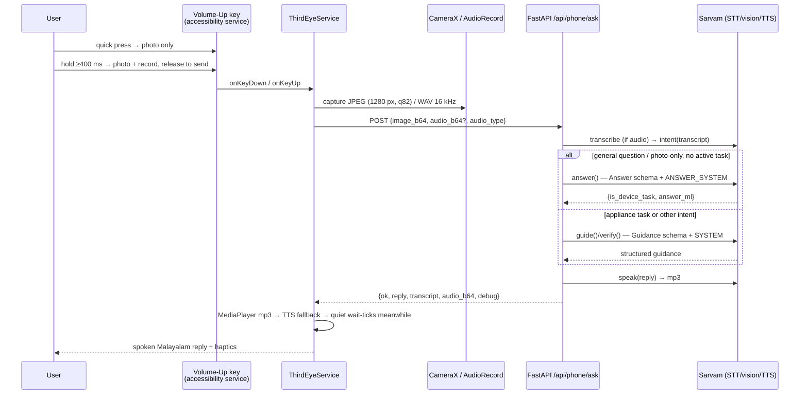

# DrishtiGuide architecture

DrishtiGuide is a Malayalam-first visual assistant for blind and low-vision users.
A PC runs the FastAPI server (Sarvam vision / STT / TTS); an Android phone is the
client that captures photos, records voice, uploads, and plays the spoken reply.

## One turn (phone → spoken reply)

## Components

| Layer | Piece | Role |
|---|---|---|
| Server | `app.py` | FastAPI app, Runtime, phone endpoints, debug viewer |
| Server | `task_engine.py` | Task state machine, `Guidance`/`Verification`/`Answer` schemas, prompts |
| Server | `sarvam_client.py` | Sarvam REST client (vision, STT `saaras:v4`, TTS `bulbul:v4-flash`) |
| Server | `camera.py` | IP-Webcam MJPEG capture (optional; `CAMERA_URL=off` for phone-only) |
| Phone | `ThirdEyeService` | Foreground service: state machine, CameraX, AudioRecord, upload, playback |
| Phone | `TriggerStateMachine` | Pure-Kotlin press/hold/send/play state machine (unit-tested) |
| Phone | `KeyAccessibilityService` | Volume-Up key filter (consumes the key while running) |
| Phone | `MainActivity` / `HistoryActivity` | Settings, pairing, debug history |

## Routing rules (`/api/phone/ask`)

1. **Photo-only press** (`capture`, no audio): no active task → `answer()`
   (general Q&A); active task → existing guide flow (resume).
2. **Voice free text** (`query`): always `answer()` first, with
   `active_task`/`pending_instruction` context when a task is running.
   `is_device_task=false` → direct Malayalam answer; `true` → guide flow.
3. **Command intents** (`verify`, `next`, `stop`, `reset`, `locate`, `repeat`,
   `simplify`, `explain`, `continue`): existing task flow, unchanged.
   English and Malayalam phrases both map (case/punctuation-insensitive).

`answer()` is bounded: ≤700-char Malayalam reply, safety caution for
gas/mains/medical/dangerous scenes, never identifies people.

## API contract

- `GET /api/phone/ping` → `{"ok": true, "ai_ready": bool}`
- `POST /api/phone/ask` (Bearer `PHONE_TOKEN`)
  - request: `{"image_b64": <JPEG>, "audio_b64": <b64|null>, "audio_type": "audio/wav|audio/mp4|audio/webm|audio/ogg|null"}`
  - response (always): `{"ok", "reply", "transcript", "audio_b64", "audio_type", "debug": {"action","route","transcript_language","timings_ms"}}`
  - statuses: 200 ok · 400 bad input · 401 bad token · 409 busy · 413 too large · 503 Sarvam/camera failure
- `GET /pair` — localhost-only QR pairing page (deep link `thirdeye://pair?url=…&token=…`)
- `GET /debug`, `/api/debug/items`, `/api/debug/{id}/image|audio` — localhost-only debug viewer (`PHONE_DEBUG=0` disables)

## Security model

- Phone API requires `Authorization: Bearer <PHONE_TOKEN>` (`hmac.compare_digest`).
- Non-phone paths are loopback-only (client host + Host header).
- Public `HOST` binding requires `PHONE_TOKEN` ≥ 24 chars (`host_binding_ok`).
- Image ≤ 16 MP / 6 MB decoded, audio ≤ 3 MB, body ≤ 10 MB.
- Token never logged; `/pair` warns the QR contains the token.
- The app stores URL+token in private SharedPreferences; no cloud storage.

## Failure handling

- **Phone**: one retry after 700 ms only on pre-response connect failures;
  100 s watchdog resets a stuck `SENDING`; quiet tick every 1.5 s while waiting;
  local TTS fallback (Malayalam if available, else English) on any failure.
- **Server**: busy → 409; Sarvam/camera errors → 503 with spoken Malayalam
  error; every request recorded under `debug/` with image, audio, meta.json.

## Measured latency (live, `scripts/bench_phone.py 5`, this PC + Sarvam)

| kind | http | route | stt med/p95 (ms) | vision med/p95 (ms) | tts med/p95 (ms) | total med/p95 (ms) | client rtt med/p95 (ms) |
|---|---|---|---|---|---|---|---|
| photo | 200 | general | – | 986 / 997 | 0 / 0 | 988 / 999 | 1003 / 1013 |
| voice | 200 | general | 383 / 458 | 1732 / 1787 | 0 / 1736 | 3003 / 3908 | 3019 / 3924 |

Voice adds STT (~0.4 s) on top of vision; photo-only is ~1 s server-side.
End-to-end on-device is typically 3–4.5 s including capture + playback.
