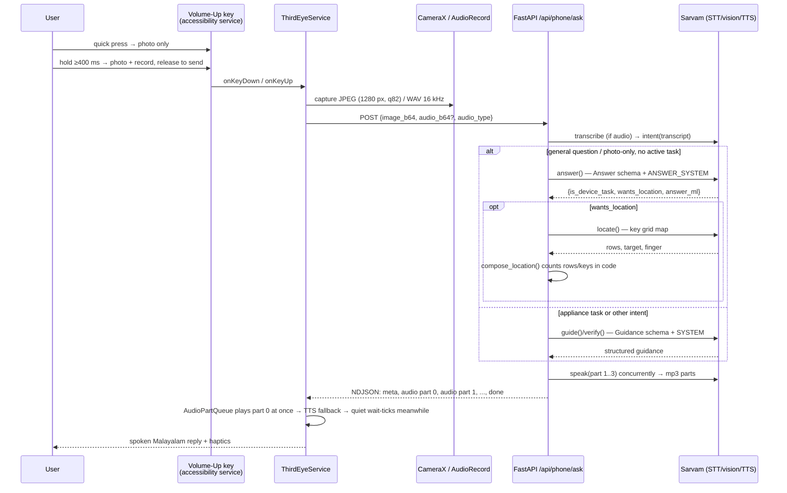

# DrishtiGuide architecture

DrishtiGuide is a Malayalam-first visual assistant for blind and low-vision users.
A PC runs the FastAPI server (Sarvam vision / STT / TTS); an Android phone is the
client that captures photos, records voice, uploads, and plays the spoken reply.

## One turn (phone → spoken reply)

## Components

| Layer | Piece | Role |
|---|---|---|
| Server | `app.py` | FastAPI app, Runtime, phone endpoints, debug viewer |
| Server | `task_engine.py` | Task state machine, `Guidance`/`Verification`/`Answer` schemas, prompts |
| Server | `sarvam_client.py` | Sarvam REST client (vision, STT `saaras:v4`, TTS `bulbul:v4-flash`) |
| Server | `camera.py` | IP-Webcam MJPEG capture (optional; `CAMERA_URL=off` for phone-only) |
| Phone | `ThirdEyeService` | Foreground service: state machine, CameraX, AudioRecord, upload, playback |
| Phone | `TriggerStateMachine` | Pure-Kotlin press/hold/send/play state machine (unit-tested) |
| Phone | `KeyAccessibilityService` | Volume-Up key filter (consumes the key while running) |
| Phone | `MainActivity` / `HistoryActivity` | Settings, pairing, debug history |

## Routing rules (`/api/phone/ask`)

0. **Where is a key** (`wants_location=true` from `answer()`): `locate()` returns a
   grid of the keys; `compose_location()` writes the Malayalam directions.
1. **Photo-only press** (`capture`, no audio): no active task → `answer()`
   (general Q&A); active task → existing guide flow (resume).
2. **Voice free text** (`query`): always `answer()` first, with
   `active_task`/`pending_instruction` context when a task is running.
   `is_device_task=false` → direct Malayalam answer; `true` → guide flow.
3. **Command intents** (`verify`, `next`, `stop`, `reset`, `locate`, `repeat`,
   `simplify`, `explain`, `continue`): existing task flow, unchanged.
   English and Malayalam phrases both map (case/punctuation-insensitive).

`answer()` is bounded: ≤700-char Malayalam reply, safety caution for
gas/mains/medical/dangerous scenes, never identifies people.

## API contract

- `GET /api/phone/ping` → `{"ok": true, "ai_ready": bool}`
- `POST /api/phone/ask` (Bearer `PHONE_TOKEN`)
  - request: `{"image_b64": <JPEG>, "audio_b64": <b64|null>, "audio_type": "audio/wav|audio/mp4|audio/webm|audio/ogg|null"}`
  - response (always): `{"ok", "reply", "transcript", "audio_b64", "audio_type", "debug": {"action","route","transcript_language","timings_ms"}}`
  - with `"stream": true` the success response is `application/x-ndjson`, one JSON object per line:
    `{"type":"meta","ok","reply","transcript","parts","debug"}`, then `{"type":"audio","index","audio_b64"}` in order
    (`audio_b64` is `null` for a part that failed), then `{"type":"done","debug":{...,"ttfa_ms"}}`.
    Errors before the reply is known (auth, 400/409/413/503) stay plain JSON with the same status codes.
  - statuses: 200 ok · 400 bad input · 401 bad token · 409 busy · 413 too large · 503 Sarvam/camera failure
- `GET /pair` — localhost-only QR pairing page (deep link `thirdeye://pair?url=…&token=…`)
- `GET /debug`, `/api/debug/items`, `/api/debug/{id}/image|audio` — localhost-only debug viewer (`PHONE_DEBUG=0` disables)

## Security model

- Phone API requires `Authorization: Bearer <PHONE_TOKEN>` (`hmac.compare_digest`).
- Non-phone paths are loopback-only (client host + Host header).
- Public `HOST` binding requires `PHONE_TOKEN` ≥ 24 chars (`host_binding_ok`).
- Image ≤ 16 MP / 6 MB decoded, audio ≤ 3 MB, body ≤ 10 MB.
- Token never logged; `/pair` warns the QR contains the token.
- The app stores URL+token in private SharedPreferences; no cloud storage.

## Failure handling

- **Phone**: one retry after 700 ms only on pre-response connect failures;
  100 s watchdog resets a stuck `SENDING`; quiet tick every 1.5 s while waiting;
  local TTS fallback (Malayalam if available, else English) on any failure.
- **Server**: busy → 409; Sarvam/camera errors → 503 with spoken Malayalam
  error; every request recorded under `debug/` with image, audio, meta.json.

## Spatial locate

For "where is the exit button?" the vision model returns a `Locate` object:
`rows` (keys per row, top to bottom and left to right, `""` for an unlabeled key),
the target's 1-based `target_row`/`target_col`, an optional fingertip position, and
`upright` / `readable` / `needs_new_image` flags. `compose_location()` in
`task_engine.py` then writes the sentence deterministically: position from the top,
from the left and from the bottom, a nearby labelled key as a landmark, or the
finger movement (`n keys left/right`, `n rows up/down`, "approximately" when the
rows have different lengths). Unusable results fall back to a Malayalam request for a
better photo. The last target is remembered for follow-ups. The grid is stored in the
debug record and drawn on `/debug`.

## Measured latency

Live, against the real Sarvam APIs from the development PC (`scripts/bench_stream.py`),
four runs per cell, an English-spoken question and a synthetic remote photo.
Numbers vary run to run.

| Question | Mode | Time to first sound (median / worst) | Total (median) |
|---|---|---|---|
| Describe this picture in detail | one response | 2.81 s / 5.12 s | 2.81 s |
| | streaming | 1.19 s / 1.92 s | 1.22 s |
| Where is the exit button? | one response | 1.96 s / 5.11 s | 1.96 s |
| | streaming | 1.79 s / 3.38 s | 1.79 s |

Earlier component timings (`scripts/bench_phone.py`, 5 runs): photo-only about 1.0 s
server-side; voice adds speech-to-text (median 0.38 s) before vision (median 1.7 s).
End-to-end on the phone also includes capture and playback and is shown per turn in the
History screen ("first sound", "net").
